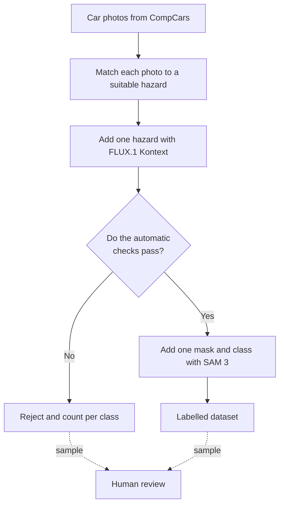

# Synthetic dataset generation for car-wash hazard detection

Open doors, roof boxes and bike racks can jam or damage an automatic car wash. A camera at the entrance could spot them, but there is no real footage to train it on.

We are building an automatic pipeline that adds hazards to car photos, rejects unrealistic results and labels the rest. The output is a dataset that a hazard detector can later be trained on.

> **Status: design phase.** There is no pipeline code yet. The first checkpoint is on 11 November 2026.

*Applied Data Science Project, Politecnico di Torino, with LINKS Foundation.*

## How it works

The pipeline runs without manual steps. People only review a sample, to measure whether the automatic checks can be trusted.

## What success looks like

| Question | Target |
| --- | --- |
| Can the model draw this hazard? | At least 50% of a class's images pass validation. Classes below this are dropped. |
| Can we trust the automatic checks? | At least 80% agreement with human review on a sample. |
| Are the labels usable? | At least 90% of masks reach IoU 0.5 against a hand-labelled sample. |

## Hazard classes

The project covers 23 classes. These 16 are named in the project brief, and we are confirming the rest.

| Group | Classes |
| --- | --- |
| Openings | Doors, trunk, hood, fuel flap, windows, sunroof |
| Roof | Roof box, rails, crossbars, bike rack |
| Loads | Ladder, kayak, surfboard |
| Rear | Towbar rack, exposed towball, trailer |

## Data and models

| Step | Resource | Note |
| --- | --- | --- |
| Source photos | [CompCars](https://mmlab.ie.cuhk.edu.hk/datasets/comp_cars/) | Non-commercial research only |
| Image editing | [FLUX.1 Kontext [dev]](https://bfl.ai/blog/flux-1-kontext-dev) | Non-commercial licence |
| Labelling | [SAM 3](https://github.com/facebookresearch/sam3) | Checkpoints require access approval |

Images are not stored in this repository. We are checking what the licences allow us to publish.

## Scope

- **In scope:** the full pipeline on CompCars, and the labelled dataset.
- **Out of scope:** training the final hazard detector. It is a possible extension if time allows.

## Getting started

Setup instructions will arrive with the first code.

## Team

Leonardo Passeri, Alessio D'Aiuto, Antonio Vetrone
