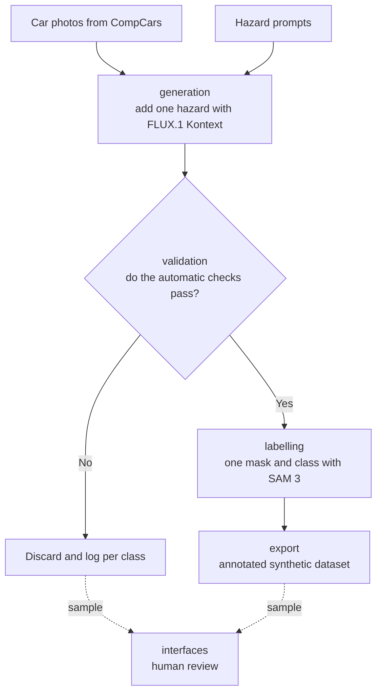

# Synthetic dataset generation for car-wash hazard detection

Open doors, roof boxes and bike racks can jam or damage an automatic car wash. A camera at the entrance could spot them, but there is no real footage to train it on.

We are building an automatic pipeline that adds hazards to car photos, rejects unrealistic results and labels the rest. The output is a dataset that a hazard detector can later be trained on.

> **Status: development phase.** Checkpoint #1 was presented on 11 November 2026 ([slides](docs/presentations/checkpoint_1.pdf)). We are now building a first end-to-end pilot on six hazard classes for Checkpoint #2 on 2 December 2026. There is no pipeline code yet.

*Applied Data Science Project, Politecnico di Torino, with LINKS Foundation.*

## How it works

Each step is a module in `src/`, with the same name.



The pipeline runs without manual steps. People only review a sample, to measure whether the automatic checks can be trusted.

## What success looks like

| Question | Target |
| --- | --- |
| Can the model draw this hazard? | At least 50% of a class's images pass validation. Classes below this are dropped. Measured on each of the six pilot classes. |
| Can we trust the automatic checks? | At least 80% agreement with human review on a sample. |
| Are the labels usable? | At least 90% of masks reach IoU 0.5 against a hand-labelled sample. |

## Repository structure

```text
README.md          what the project is and how to run it
data/              prompts and manifests (no images, see licences below)
src/
  generation/      adds one hazard to a car photo
  validation/      rejects wrong or unrealistic edits
  labelling/       one mask and class per accepted image
  export/          checks and writes the annotated dataset
  interfaces/      human review of a sample
tests/             tests linked to requirements R1-R3
notebooks/         pilot experiments and the final notebook
results/           quality reports: pass rates, agreement, IoU
docs/              slides and reports
```

| Module | Input | Output | Check |
| --- | --- | --- | --- |
| [generation](src/generation) | Car photo and hazard prompt | Edited image and metadata | R1 |
| [validation](src/validation) | Original and edited image, target class | Accept or reject, with check scores | R1 |
| [labelling](src/labelling) | Accepted image and class | Segmentation mask and class | R2 |
| [export](src/export) | Images, masks and metadata | Annotated synthetic dataset | R3 |
| [interfaces](src/interfaces) | Sample of accepted and rejected images | Reviewer decisions | Agreement KPI |

Each module's README names its owner. The requirements are listed in [tests](tests).

## Hazard classes

The project brief defines 23 hazard classes. We implement six of them end to end. Together they cover openings, roof loads and rear hazards, from large and easy to small and hard.

| Pilot class | Group | Viewpoints where it is visible | Why it is in the pilot |
| --- | --- | --- | --- |
| Open front door | Openings | Side, front three-quarter, rear three-quarter | The most common hazard at the entrance |
| Open trunk or tailgate | Openings | Rear, rear three-quarter | Large and easy to see |
| Open hood | Openings | Front, front three-quarter | Also visible in the CompCars surveillance photos, which are front views |
| Roof box | Roof | Side, front three-quarter, rear three-quarter | An object added to the car, not a part that opens |
| Roof bike rack | Roof | Side, front three-quarter, rear three-quarter | A thin, complex shape that tests the masks |
| Exposed towball | Rear | Rear, rear three-quarter | A small object: the hardest case |

Source photos are selected only from the viewpoints listed for each class, so the requested hazard can be seen.

The other 17 classes are an extension, to be added once the pipeline works on the pilot:

| Group | Classes not in the pilot |
| --- | --- |
| Openings | Fuel flap, windows, sunroof |
| Roof | Rails, crossbars |
| Loads | Ladder, kayak, surfboard |
| Rear | Towbar rack, trailer |
| To be confirmed with LINKS | 7 classes not named in the project brief |

## Data and models

| Step | Resource | Note |
| --- | --- | --- |
| Source photos | [CompCars](https://mmlab.ie.cuhk.edu.hk/datasets/comp_cars/) | Non-commercial research only |
| Image editing | [FLUX.1 Kontext [dev]](https://bfl.ai/blog/flux-1-kontext-dev) | Non-commercial licence |
| Labelling | [SAM 3](https://github.com/facebookresearch/sam3) | Checkpoints require access approval |

Images are not stored in this repository. We are checking what the licences allow us to publish.

## Scope

- **In scope:** the full pipeline on CompCars for the six pilot classes, and their labelled dataset.
- **Extension:** the other 17 hazard classes, once the pilot meets its targets.
- **Out of scope:** training the final hazard detector. It is a possible extension if time allows.

## Documents

- [Checkpoint #1 slides](docs/presentations/checkpoint_1.pdf), 11 November 2026
- [Project pitch](LINKS_ADSP-Project_Synthetic_dataset_generation_for_car-wash_hazard_detection.pdf), from LINKS Foundation

## Getting started

Setup instructions will arrive with the first code.

## Team

Leonardo Passeri, Alessio D'Aiuto, Antonio Vetrone
