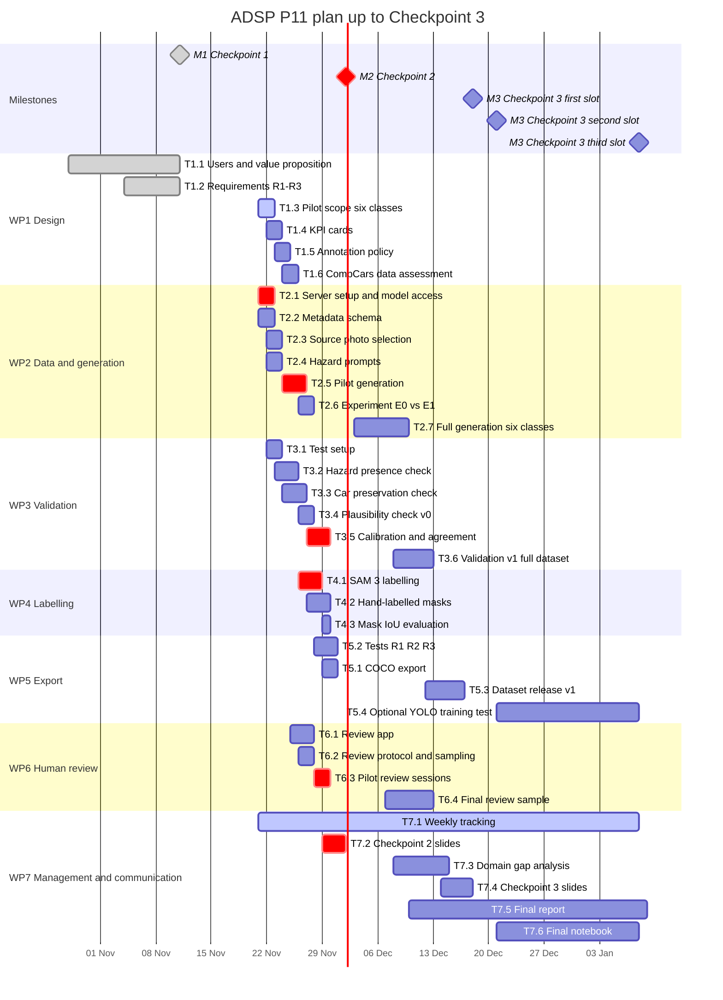

# Gantt chart

When each task in the [WBS](wbs.md) happens and what depends on what, up to Checkpoint #3. Task IDs match the WBS. Red bars are on the critical path to the next checkpoint.

## Dependencies

The critical path to Checkpoint #2 runs through the GPU server: nothing can be measured until the first edits exist.

| Task | Needs | Why |
| --- | --- | --- |
| T2.5 Pilot generation | T2.1, T2.3, T2.4 | FLUX.1 Kontext must run on the server, with the photos and prompts chosen |
| T3.5 Calibration and agreement | T2.5, T3.2-T3.4, T6.3 | Thresholds are set and checked against human decisions on generated images |
| T4.1 SAM 3 labelling | T2.5 | Masks are drawn on the generated images |
| T4.3 Mask IoU evaluation | T4.1, T4.2, T1.5 | IoU needs SAM 3 masks, reference masks and one shared definition of each mask |
| T6.3 Pilot review sessions | T2.5, T6.1, T6.2 | Reviewers need images, the app and the sampling protocol |
| T5.1 COCO export | T2.2, T4.1 | The export reads the shared metadata and the masks |
| T7.2 Checkpoint #2 slides | T2.6, T3.5, T4.3 | The slides report the experiment and the first value of each KPI |

T3.2-T3.4, T6.1 and T5.2 do not wait for the server: they start on small placeholder images that follow the shared metadata schema (T2.2).

## Schedule risks

| Risk | Affected tasks | Response |
| --- | --- | --- |
| SAM 3 or CompCars access arrives late | T2.3, T4.1 | Request access on day one; start with the photos already downloaded |
| FLUX.1 Kontext is slow on the 16 GB server | T2.5, T2.7 | Measure seconds per image in T2.1 and size the pilot to fit; run overnight |
| The server is shared with other users | T2.5, T2.7 | Book GPU time and run the stages one after the other |
| Fewer than 50% of a class's edits pass validation | T2.7 | Revise the prompt once; if it still fails, drop the class as the KPI rule says |
